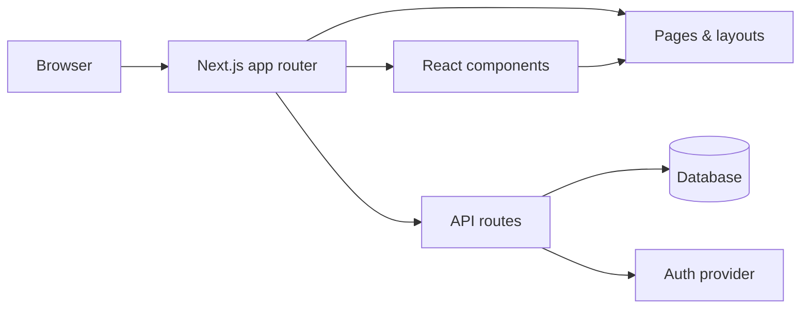

# Predictry

One search bar across every major prediction market. Searches **Polymarket** + **Kalshi** in parallel, with synonym expansion, faceted filters, cross-platform arbitrage detection, and a local watchlist — no login required.

## Architecture / How it Works




## Why it exists

Single-platform prediction sites (Polymarket, Kalshi) bury search inside categories, hide it behind login, or don't show cross-platform prices at all. Predictry gives you one unified search with:

- **Cross-platform** — search Polymarket and Kalshi at the same time
- **Semantic expansion** — "btc" → "bitcoin"; "shutdown" → "government shutdown"
- **Faceted filters** — category, platform, YES probability range, time-to-close
- **Arbitrage detection** — flags the same event priced differently on two platforms
- **Anonymous watchlist** — saved in localStorage, no account
- **Sub-second responses** — typed query → scored results in <100ms

## Stack

- **Next.js 14** (App Router) + **TypeScript** + **Tailwind CSS**
- Public data sources: Polymarket Gamma API, Kalshi Trade API, Manifold Markets API
- Zero DB, zero auth — everything runs on the server in-memory with a 60s cache

## Run it

```bash
npm install
npm run dev
# open http://localhost:3000
```

## API

| Endpoint | Description |
|---|---|
| `GET /api/search` | Unified search across all platforms |
| `GET /api/arbitrage` | Cross-platform arbitrage groups |
| `GET /api/market/[id]` | Single market + related (same event on other platforms) |
| `GET /api/health` | Status + market counts per platform |

Example:

```bash
curl 'http://localhost:3000/api/search?q=bitcoin&limit=5'
curl 'http://localhost:3000/api/search?q=Fed+rate+cut&minYes=0.4&maxYes=0.7'
curl 'http://localhost:3000/api/arbitrage'
```

## How search works

1. Fetch the top 200 Polymarket markets (sorted by 24h volume + start date) and the top 500 Kalshi markets in parallel
2. Normalize each into a `{ title, description, yesPrice, noPrice, volume, closesAt, category, platform }` shape
3. Infer a useful category (Polymarket's API doesn't return one) using keyword rules
4. Score every market against the query:
   - Title hits: 15 points
   - Tag/category hits: 4–5 points
   - Description hits: 1 point
   - Exact phrase in title: +50 points
   - Coverage bonus: +20 × (matched query tokens / total tokens)
   - Markets with zero title hits are penalized to 0.15× (filters out "noise" matches)
5. Sort by score with a small activity boost for popular markets

## Project structure

```
app/
  api/{search,arbitrage,market,health}/route.ts
  page.tsx, layout.tsx, globals.css
components/
  SearchBar.tsx, Filters.tsx, MarketCard.tsx, ArbitrageList.tsx
lib/
  aggregator.ts, match.ts, format.ts, types.ts
  sources/{polymarket,kalshi,manifold}.ts
  useWatchlist.ts
```

## Data freshness

Markets are cached in memory for 60 seconds. The next request after expiry re-fetches all sources in parallel. Each upstream API is called with `cache: "no-store"` to avoid Next.js's per-fetch cache (the responses exceed 2MB).

## Disclaimer

Not financial advice. Prediction markets can be illiquid and prices can be stale.
